# Card Battle Lab Enhanced

More card information for [Card Battle Lab](https://cardbattlelab.com/play/), on your phone and
on your computer.

- An **Android app** that opens the game.
- A **Chrome extension** for the game in Chrome.

The additions show information only. They do not change the game rules.

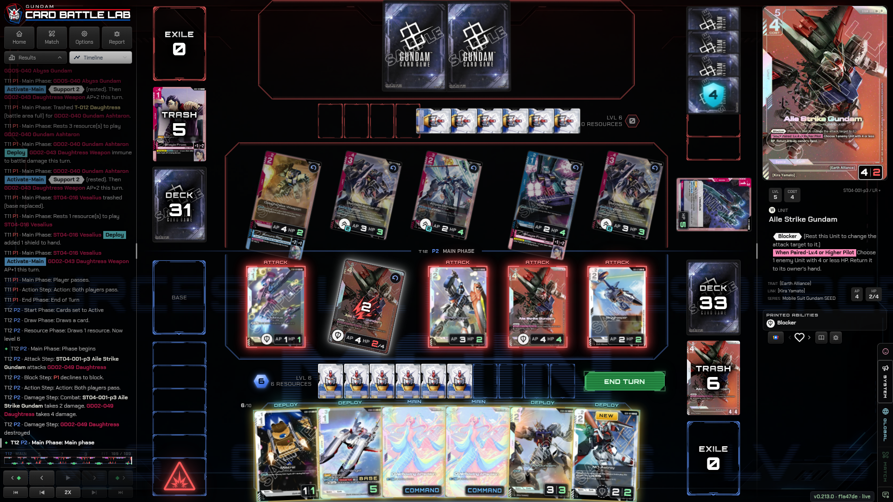

## Features

### Your hand

Each card in your hand shows its `AP | HP`, Pilot bonuses, type and keyword icons. A gold glow
shows the cards that you can play now. The cards that you cannot play fade out. The count `6/10`
shows the cards in your hand and the hand limit. The count is yellow at 10 cards and red above 10.

| Original | Enhanced |
| --- | --- |
| 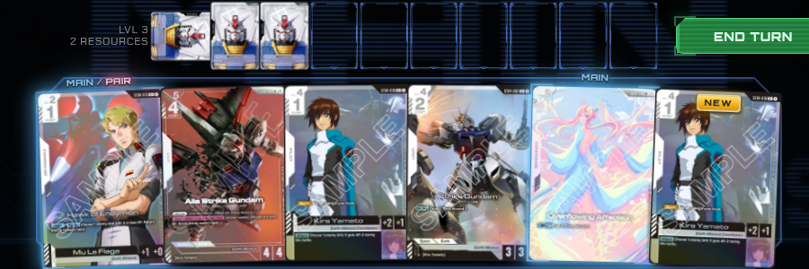 | 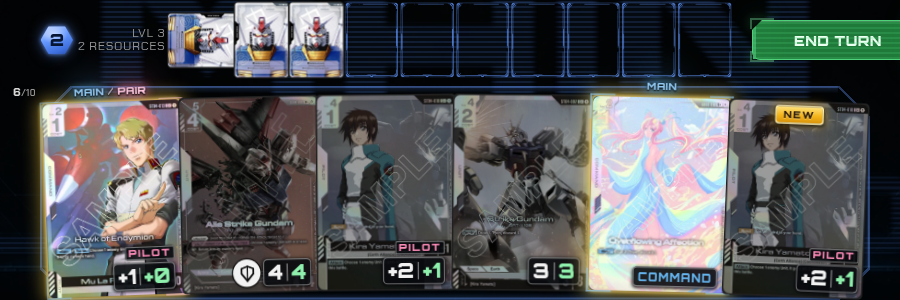 |

### Active resources

A hexagon on the left of each resource row shows how many resources can pay costs now. In the
picture above, you have 3 resources and you used 1 of them, so the hexagon shows `2`.

### The field

Each Unit and Base in play shows its live AP and HP. Damage shows in red, for example `HP 2/4`.
Icons show the keywords that are active now. A rested Unit turns only a small angle, so you can
read its numbers.

| Original | Enhanced |
| --- | --- |
| 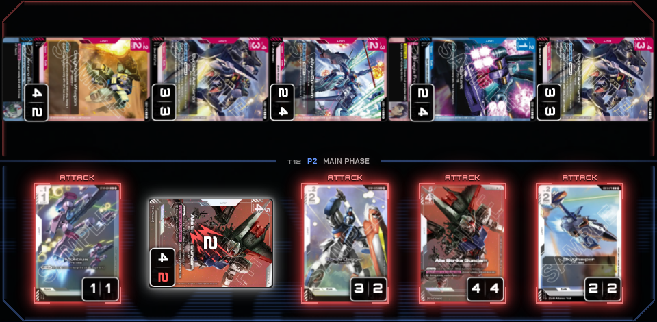 | 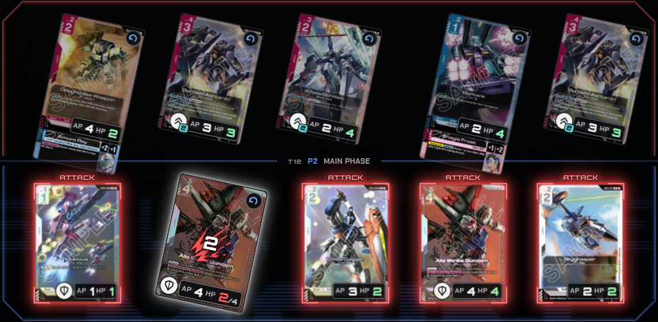 |

### Card view

When a Unit changes, for example when it takes damage, the site shows its live AP/HP in a
separate box. The extension moves this box onto the printed AP/HP box of the card. The card
view also shows a "Printed abilities" list with the keywords that the card has or gives.

| Original | Enhanced |
| --- | --- |
| 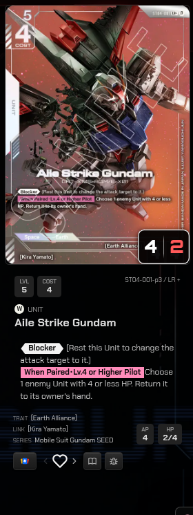 | 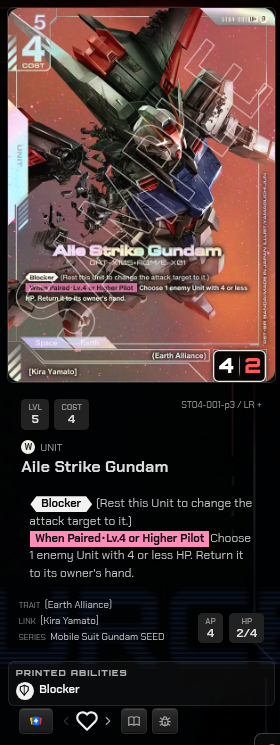 |

### Rarity foil

Each card shows the foil finish of its rarity. The card tilts when you move the pointer on it,
or when you push and move a finger on it.

| R | LR | C+ |
| --- | --- | --- |
| 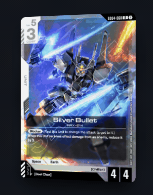 | 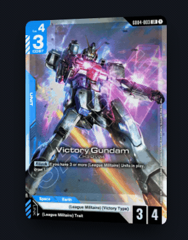 | 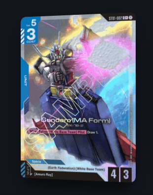 |

| U+ | R+ | LR+ |
| --- | --- | --- |
| 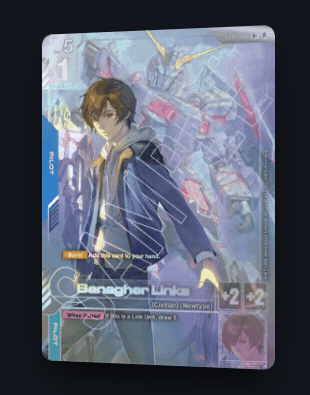 | 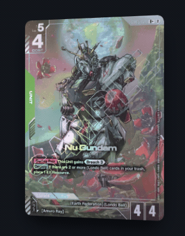 | 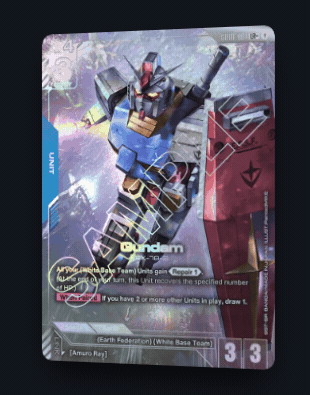 |

### On the phone

The Android app has all the additions.

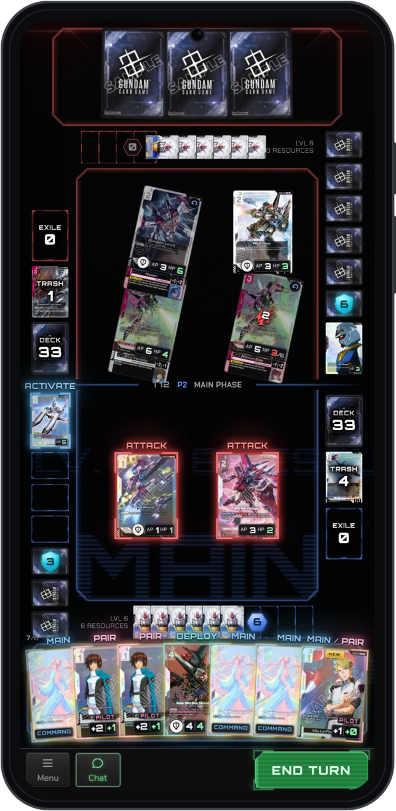

### Card info reference

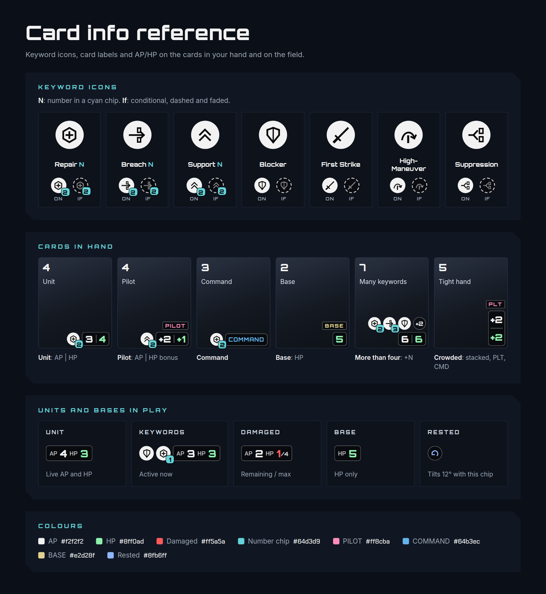

## Install

Get the files from the [latest release](https://github.com/danieljsv/cardbattlelab-enhanced/releases/latest).

### Android app

You need Android 8.0 or later.

1. On your phone, open the latest release.
2. Download `cardbattlelab-enhanced-x.y.z.apk`.
3. Open the file. If Android asks, let your browser install apps.
4. Open the **CBL** app and sign in to the site.

To update, install the APK of the new release. You keep your sign-in.

### Chrome extension

You need Chrome 111 or later.

1. Download `cardbattlelab-enhanced-x.y.z-chrome.zip`.
2. Extract the ZIP file to a folder. Keep this folder.
3. In Chrome, open `chrome://extensions`.
4. Turn on **Developer mode** (top right).
5. Click **Load unpacked** and select the folder.
6. Open or reload [Card Battle Lab](https://cardbattlelab.com/play/).

To update, extract the new ZIP file into the same folder. Then click **Reload** on the extension
in `chrome://extensions`.

## Settings

All additions are on when you install the extension. To turn one off or on:

1. Click the extension icon in the Chrome toolbar. If you cannot see the icon, click the
   puzzle-piece icon and pin the extension.
2. Click the switch of the addition.

The change applies to open game tabs immediately.

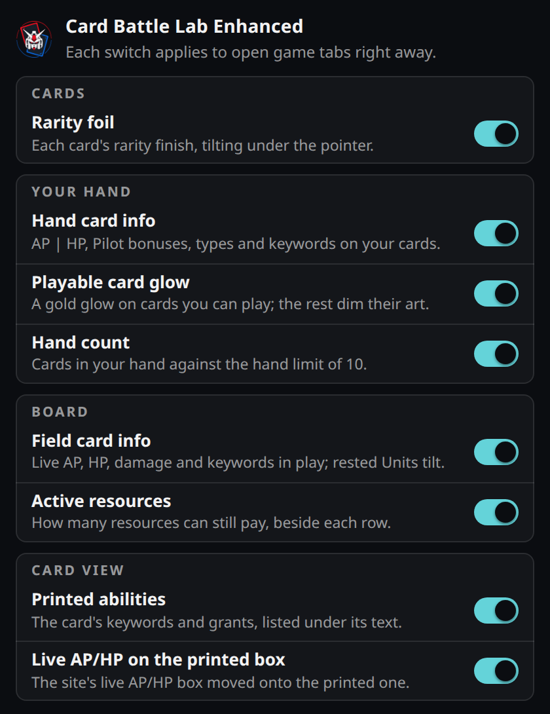

The Android app has no settings menu. All additions are on.

## Build from the source

You need Python 3.10 or later and Bash.

```bash
./build.sh
```

The extension is in `build/extension/`. To build the Android app, you also need JDK 17 and the
Android SDK:

```bash
./android/gradlew -p android assembleRelease
```

To run the tests, you also need Node.js 18 or later:

```bash
python3 -m unittest discover -s tests
node --test .github/scripts/*.test.mjs tests/*.test.mjs
```

## About

This is an unofficial fan project. It is not related to Card Battle Lab or Bandai.
